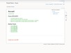

- nom :
- prénom :
- URL Netlify :

# TP4 – Accordéon HTML / CSS / JS

Accordéon construit avec les balises natives `<details>` et `<summary>`, stylé en CSS et piloté en JavaScript pour qu'un seul panneau reste ouvert à la fois.

## Aperçu des images

Les images sont affichées à leur **taille réelle (102 × 77 px)**, sans agrandissement, pour qu'elles restent nettes.

<p>
  
  
  
</p>

## Structure du projet

| Fichier | Rôle |
| --- | --- |
| [index.html](index.html) | Page de test contenant l'accordéon |
| [src/css/components/accordeon.css](src/css/components/accordeon.css) | Styles de l'accordéon |
| [src/js/script.js](src/js/script.js) | Referme les autres panneaux au clic |
| [assets/img/](assets/img/) | Images des `summary` |

## 1. Le CSS

L'état ouvert se cible avec l'attribut `open` :

```css
details {
  /* fermé et ouvert */
}

details[open] {
  /* ouvert */
}
```

Ce qui a été fait :

- chaque `details` est une carte (bordure, coins arrondis, ombre) ;
- le panneau ouvert a une bordure et une ombre bleues ;
- l'image du `summary` est en noir et blanc quand le panneau est fermé, en couleur au survol et à l'ouverture ;
- **les images ne sont jamais étirées** (`width: auto; height: auto; max-width: 100%`) : comme elles ne font que 102 × 77 px, les agrandir les rendrait floues.

## 2. Sans JavaScript

Il suffit de cliquer sur un `summary` pour ouvrir ou fermer son panneau. Plusieurs panneaux peuvent alors être ouverts en même temps.

## 3. Refermer les autres panneaux en JavaScript

Test dans la console :

```js
accordeon = document.querySelector(".accordeon");
accordeon.querySelectorAll("details").forEach((det) => (det.open = false));
```

Version finale dans [script.js](src/js/script.js) : au clic sur un `summary`, tous les autres `details` sont refermés.

```js
const accordeon = document.querySelector(".accordeon");

accordeon.querySelectorAll("details > summary").forEach((summary) => {
  summary.addEventListener("click", () => {
    const current = summary.parentElement;
    accordeon.querySelectorAll("details").forEach((det) => {
      if (det !== current) det.open = false;
    });
  });
});
```

## 4. Triangle CSS

Le triangle d'origine est supprimé :

```css
.accordeon > details > summary {
  list-style: none;
}
.accordeon > details > summary::marker,
.accordeon > details > summary::-webkit-details-marker {
  display: none;
}
```

Il est remplacé par un [triangle CSS](https://css-tricks.com/snippets/css/css-triangle/) dessiné avec des bordures dans `summary::after`, qui pivote de 90° quand le panneau est ouvert.

## Ressources

- [Using & styling the details element – CSS-Tricks](https://css-tricks.com/using-styling-the-details-element/)
- [CSS triangle – CSS-Tricks](https://css-tricks.com/snippets/css/css-triangle/)
